# 🗄️ Estrutura do Banco de Dados — MoneyControl

> **Banco de Dados:** MySQL 8.0+ (InnoDB; Wamp local: 8.0.31)
> **ORM:** Laravel Eloquent  
> **Convenção de nomes:** tabelas e colunas em inglês (snake_case), domínio em português na camada de aplicação

## Estado e Migrations (16/10/2026)

A estrutura abaixo está implementada nas 17 migrations (três de infraestrutura e quatorze
financeiras/perfil), aplicadas no MySQL local `gestao_financeira` e no banco exclusivo
`gestao_financeira_testing`. Criação, reversão e reaplicação também foram testadas em SQLite
em memória; nenhum rollback ou reset foi executado no MySQL.
Os onze Models financeiros, seus relacionamentos e casts estão implementados.
`TitleService`, `RecurrenceService` e `Money` implementam criação/parcelas,
baixas parciais/totais, idempotência, cancelamento e cálculo de recorrência.
`FinancialAccountService` calcula saldo por conta/data; `FinancialAnalyticsService` apenas
consulta as baixas/estornos e respectivas formas para dashboard/relatório, sem criar
tabela, PDF persistido ou novos movimentos; `CatalogService` valida cadastros
e protege vínculos históricos. Edição controlada de títulos, rotina de vencidos e
inicialização dos cadastros padrão estão implementadas. `SettlementReversalService`
preserva a baixa original, reabre principal e invalida recibos existentes.
PDF privado e notificações deduplicadas estão implementados; importação/exportação seguem pendentes.

Validação: **324 testes / 1446 assertions em SQLite**; última regressão completa MySQL: **158 testes / 1003 assertions**.
No MySQL foram conferidas 21 tabelas com InnoDB e `utf8mb4_unicode_ci`, 22 FKs restritivas,
índices, precisão de `DECIMAL(15,2)`, enums, unicidade e consultas com proprietário indireto.
Testes MySQL comuns fazem rollback; concorrência usa commits temporários e limpeza limitada
ao proprietário exclusivo da fixture. PDF também usa fixtures confirmadas, removidas ao final.
Dez disputas confirmam espera no InnoDB.
Não foram executados seeders no banco da aplicação. Uma migration incremental adicionou
estornos, origem do próximo ciclo e invalidação de recibos. A etapa atual adiciona
snapshot/hash, deduplicação e sequência de documentos, sem alterar valores financeiros legados.

A etapa de autenticação/interface não adicionou tabelas ou migrations: permanecem
17 migrations, 21 tabelas e 22 FKs restritivas. `AuthController` registra o usuário
e chama `FinancialDefaultsService` na mesma transação. Os únicos dados de onboarding
são 12 categorias e 7 formas padrão pertencentes ao novo usuário; não cria contas,
saldos ou títulos. Recuperação usa `password_reset_tokens` existente e sessão usa
a infraestrutura já disponível. Os testes de navegador usaram SQLite temporário,
sem usuários demonstrativos ou dados financeiros inseridos no MySQL da aplicação.

Integração de operações em `TitleDetail` não exigiu novas migrations: usa as tabelas,
FKs e índices de idempotência existentes. Baixa grava principal/ajustes e formas
via `TitleService`; estorno grava auditoria separada, reabre principal e invalida
recibos via `SettlementReversalService`. PDF é emitido após commit financeiro
via `ReceiptService`; nenhuma transação externa engloba arquivo e baixa.
Edição preserva IDs de parcelas e vínculos não alterados; cancelamento não exclui
histórico. A criação de recorrência pela UI usa `generated_by_settlement_id`
já existente para rastrear o ciclo criado na baixa total.
Testes novos de PDF usam SQLite em memória e diretórios temporários; teardown
desvincula autorreferências somente nesse banco descartável antes de reverter
schema. Nenhuma limpeza global ou reset foi executado no MySQL.

As migrations usam índices B-tree compatíveis com MySQL e SQLite, sem GIN ou índices parciais.
Configuração MySQL: `utf8mb4`, `utf8mb4_unicode_ci`, modo estrito e engine InnoDB.
Essa collation faz comparações textuais sem distinção de maiúsculas/minúsculas e acentos,
inclusive nas restrições de unicidade. Busca por prefixo pode aproveitar índices; `%termo%`
não tem a mesma garantia. Busca textual especializada poderá ser projetada posteriormente.

| Ordem | Migration em `database/migrations/` |
|---|---|
| Base | `0001_01_01_000000_create_users_table.php` |
| 1 | `2026_10_15_000001_add_profile_fields_to_users_table.php` |
| 2 | `2026_10_15_000002_create_categories_table.php` |
| 3 | `2026_10_15_000003_create_financial_accounts_table.php` |
| 4 | `2026_10_15_000004_create_contacts_table.php` |
| 5 | `2026_10_15_000005_create_payment_types_table.php` |
| 6 | `2026_10_15_000006_create_titles_table.php` |
| 7 | `2026_10_15_000007_create_title_installments_table.php` |
| 8 | `2026_10_15_000008_create_title_settlements_table.php` |
| 9 | `2026_10_15_000009_create_title_settlement_methods_table.php` |
| 10 | `2026_10_15_000010_create_receipts_table.php` |
| 11 | `2026_10_15_000011_create_notifications_table.php` |
| 12 | `2026_10_15_000012_add_idempotency_to_title_settlements_table.php` |
| 13 | `2026_10_16_000001_add_auditable_settlement_reversals.php` |
| 14 | `2026_10_16_000002_add_receipt_snapshots_and_notification_deduplication.php` |

O skeleton também mantém as tabelas de infraestrutura `password_reset_tokens`, `sessions`,
`cache`, `cache_locks`, `jobs`, `job_batches` e `failed_jobs`. Elas não integram o diagrama financeiro.

### Garantias e Limites

- Todas as FKs financeiras usam `RESTRICT` na exclusão física para preservar vínculos e histórico. Excluir um usuário com registros financeiros também é bloqueado; a política de encerramento de conta ainda será implementada.
- `contacts.code` e `titles.title_number` são únicos **por usuário**; códigos de usuários diferentes podem coincidir. Soft deletes não liberam esses números.
- `title_installments` tem unicidade em `(title_id, installment_number)`.
- `receipts.receipt_number` é globalmente único e `settlement_id` é único, permitindo um recibo por baixa.
- Valores monetários são `DECIMAL(15,2)`. `enum()` do Laravel gera `ENUM` nativo no MySQL e `VARCHAR` com `CHECK` no SQLite. Mantenha o modo estrito do MySQL para rejeitar enums inválidos e valores fora dos limites.
- `id()` gera `BIGINT UNSIGNED AUTO_INCREMENT`; `foreignId()` e `unsignedBigInteger()` geram `BIGINT UNSIGNED`. `unsignedInteger()` gera `INT UNSIGNED` e `boolean()` é representado por `TINYINT(1)` no MySQL.
- `timestamps()` gera colunas anuláveis sem default de banco; Eloquent atribuirá as datas ao persistir Models.
- FKs não garantem que contatos, categorias, contas e títulos pertençam ao mesmo usuário. `TitleService` valida esses vínculos, tipos/atividade, centavos, saldo, parcelas e raiz de recorrência. Gravações diretas nos Models não têm essas garantias.
- Numeração usa bloqueio do usuário até o commit, lê o maior sufixo `REC`/`PAG` e inclui títulos excluídos logicamente. Baixas serializam usuário/título/parcelas e exigem UUID de idempotência, com índice único por título e hash do pedido normalizado.
- A migration 12 é incremental e não muda valores nem faz backfill de baixas antigas. `idempotency_key` e `request_hash` ficam nulos no histórico antigo; novas baixas pelo Service sempre os preenchem.
- A migration 13 mantém as origens/recibos antigos nulos, sem tentar adivinhar vínculos de recorrência. SQLite usa `ALTER TABLE ADD COLUMN ... REFERENCES` para preservar os `CHECK` dos enums; reversão e reaplicação são testadas somente em SQLite.
- `settlement_reversals.settlement_id` é único: uma baixa só pode ser estornada uma vez. O UUID do estorno é único por usuário, e o hash normalizado protege reenvios com conteúdo diferente.
- `titles.generated_by_settlement_id` é anulável e único, associando um próximo ciclo à baixa que o gerou. O vínculo pai continua apontando diretamente à raiz.
- Estorno preserva valores e IDs de baixa/formas, cancela somente ciclos sem histórico, marca `receipts.voided_at` e recalcula estados na mesma transação. Não há estorno em cascata.
- A migration 14 adiciona campos anuláveis de snapshot/hash e deduplicação, preservando recibos/notificações antigos. Não infere snapshot/hash de PDFs legados.
- `document_sequences` mantém contador global de recibos; a migration inicializa com o maior sufixo de números legados `RCB-AAAA-<numero>` reconhecíveis. Não altera números existentes.
- Emissão bloqueia usuário/contador e verifica unicidade por baixa. Não aceita transação externa, para possibilitar cleanup normal de arquivo se a emissão falhar.
- Deduplicação é única em `(user_id, deduplication_key)`; nulos legados permanecem permitidos. O Service calcula chave por evento/parcela/vencimento, não por dia.
- `notifications` é uma tabela customizada; não corresponde ao esquema do canal `database` nativo do Laravel. O relacionamento implementado em `User` chama-se `financialNotifications()`, com `App\Models\Notification` e `unread()`.
- Os Models financeiros estendem `FinancialModel`, com `OwnerScope` que restringe consultas ao usuário autenticado e retorna vazio sem identidade. Parcelas/baixas pertencem ao proprietário do título; formas pertencem ao proprietário do título da baixa.
- `Contact` e `Title` usam `SoftDeletes`. Referências históricas a contatos, título pai e títulos de parcelas/baixas incluem registros excluídos logicamente sem remover o filtro de proprietário.
- A tela de contatos usa os campos já existentes de endereço e observações, e o arquivamento/restauração apenas altera `deleted_at`. A página de preferências grava `users.theme` e `users.notification_days_before`; esta etapa não exigiu migration.

---

## 📑 Índice

- [Diagrama ER (Mermaid)](#diagrama-er)
- [Descrição Detalhada das Tabelas](#descrição-detalhada-das-tabelas)
  - [users](#users)
  - [categories](#categories)
  - [financial_accounts](#financial_accounts)
  - [contacts](#contacts)
  - [payment_types](#payment_types)
  - [titles](#titles)
  - [title_installments](#title_installments)
  - [title_settlements](#title_settlements)
  - [settlement_reversals](#settlement_reversals)
  - [title_settlement_methods](#title_settlement_methods)
  - [receipts](#receipts)
  - [document_sequences](#document_sequences)
  - [notifications](#notifications)
- [Relacionamentos](#relacionamentos)
- [Índices e Performance](#índices-e-performance)
- [Seeders Iniciais](#seeders-iniciais)

---

## 📊 Diagrama ER

```mermaid
erDiagram
    USERS {
        bigint id PK
        string name
        string email UK
        string password
        string remember_token
        string avatar
        string theme
        int notification_days_before
        timestamp email_verified_at
        timestamp created_at
        timestamp updated_at
    }

    CATEGORIES {
        bigint id PK
        bigint user_id FK
        string name
        enum type
        string color
        string icon
        boolean active
        timestamp created_at
        timestamp updated_at
    }

    FINANCIAL_ACCOUNTS {
        bigint id PK
        bigint user_id FK
        string name
        enum type
        decimal initial_balance
        string color
        string icon
        boolean active
        timestamp created_at
        timestamp updated_at
    }

    CONTACTS {
        bigint id PK
        bigint user_id FK
        string code
        enum type
        string name
        string document
        string email
        string phone
        string address
        string neighborhood
        string city
        string state
        string zip_code
        text notes
        boolean active
        timestamp created_at
        timestamp updated_at
        timestamp deleted_at
    }

    PAYMENT_TYPES {
        bigint id PK
        bigint user_id FK
        string name
        enum type
        boolean active
        timestamp created_at
        timestamp updated_at
    }

    TITLES {
        bigint id PK
        bigint user_id FK
        bigint contact_id FK
        bigint category_id FK
        bigint financial_account_id FK
        bigint parent_title_id FK
        bigint generated_by_settlement_id FK, UK
        string title_number
        enum title_type
        string description
        string document_number
        decimal original_value
        int installments_count
        int current_installment
        date issue_date
        date due_date
        enum status
        boolean is_recurring
        enum recurrence_type
        int recurrence_day
        int recurrence_month
        string reference
        text notes
        timestamp created_at
        timestamp updated_at
        timestamp deleted_at
    }

    TITLE_INSTALLMENTS {
        bigint id PK
        bigint title_id FK
        bigint financial_account_id FK
        int installment_number
        decimal value
        date due_date
        enum status
        timestamp created_at
        timestamp updated_at
    }

    TITLE_SETTLEMENTS {
        bigint id PK
        bigint title_id FK
        bigint title_installment_id FK
        date settlement_date
        decimal original_value
        decimal discount
        decimal interest
        decimal fine
        decimal total_value
        text notes
        string idempotency_key "unique por titulo"
        string request_hash
        timestamp created_at
        timestamp updated_at
    }

    TITLE_SETTLEMENT_METHODS {
        bigint id PK
        bigint settlement_id FK
        bigint payment_type_id FK
        bigint financial_account_id FK
        decimal value
        timestamp created_at
        timestamp updated_at
    }

    SETTLEMENT_REVERSALS {
        bigint id PK
        bigint settlement_id FK, UK
        bigint user_id FK
        date reversal_date
        text reason
        string idempotency_key "unique por usuario"
        string request_hash
        timestamp created_at
        timestamp updated_at
    }

    RECEIPTS {
        bigint id PK
        bigint user_id FK
        bigint settlement_id FK, UK
        string receipt_number UK
        date issue_date
        string pdf_path
        timestamp voided_at
        json snapshot
        string pdf_sha256
        timestamp created_at
        timestamp updated_at
    }

    NOTIFICATIONS {
        bigint id PK
        bigint user_id FK
        string title
        text message
        enum type
        string notifiable_type
        bigint notifiable_id
        timestamp read_at
        string deduplication_key "unique por usuario"
        timestamp created_at
        timestamp updated_at
    }

    DOCUMENT_SEQUENCES {
        string name PK
        bigint last_number
    }

    USERS ||--o{ CATEGORIES : "possui"
    USERS ||--o{ FINANCIAL_ACCOUNTS : "possui"
    USERS ||--o{ CONTACTS : "possui"
    USERS ||--o{ PAYMENT_TYPES : "possui"
    USERS ||--o{ TITLES : "possui"
    USERS ||--o{ RECEIPTS : "possui"
    USERS ||--o{ NOTIFICATIONS : "recebe"

    CONTACTS |o--o{ TITLES : "vinculado a"
    CATEGORIES |o--o{ TITLES : "classifica"
    FINANCIAL_ACCOUNTS |o--o{ TITLES : "destino de"
    FINANCIAL_ACCOUNTS |o--o{ TITLE_INSTALLMENTS : "conta da parcela"
    TITLES ||--o{ TITLE_INSTALLMENTS : "gera"
    TITLES ||--o{ TITLE_SETTLEMENTS : "recebe baixa"
    TITLES |o--o{ TITLES : "recorrência pai"

    TITLE_INSTALLMENTS |o--o{ TITLE_SETTLEMENTS : "baixada por"
    TITLE_SETTLEMENTS ||--o{ TITLE_SETTLEMENT_METHODS : "usa formas de pagamento"
    TITLE_SETTLEMENT_METHODS }o--|| PAYMENT_TYPES : "forma usada"
    TITLE_SETTLEMENT_METHODS }o--|| FINANCIAL_ACCOUNTS : "debitada de"
    TITLE_SETTLEMENTS ||--o| RECEIPTS : "gera recibo"
    TITLE_SETTLEMENTS ||--o| SETTLEMENT_REVERSALS : "estornada por"
    TITLE_SETTLEMENTS |o--o| TITLES : "gera proximo ciclo"
    USERS ||--o{ SETTLEMENT_REVERSALS : "registra"
```



---

## 📋 Descrição Detalhada das Tabelas

---

### `users`
> Tabela do skeleton Laravel, usada pelo Auth nativo e onboarding atômico. Estendida com campos de perfil e preferências.

| Coluna | Tipo | Nulo | Padrão | Descrição |
|---|---|---|---|---|
| `id` | BIGINT UNSIGNED AUTO_INCREMENT | Não | — | Chave primária |
| `name` | VARCHAR(255) | Não | — | Nome completo do usuário |
| `email` | VARCHAR(255) | Não | — | E-mail (único) |
| `password` | VARCHAR(255) | Não | — | Hash da senha |
| `avatar` | VARCHAR(255) | Sim | NULL | Caminho da foto de perfil |
| `theme` | ENUM | Não | `'dark'` | Tema persistido da interface: `dark` ou `light` |
| `notification_days_before` | INT UNSIGNED | Não | `7` | Dias de antecedência para alertas de vencimento; tela valida 0 a 365 |
| `email_verified_at` | TIMESTAMP | Sim | NULL | Data de verificação do e-mail |
| `remember_token` | VARCHAR(100) | Sim | NULL | Token de "lembrar-me" |
| `created_at` | TIMESTAMP | Sim | NULL | Data de criação preenchida pelo Eloquent |
| `updated_at` | TIMESTAMP | Sim | NULL | Data de atualização preenchida pelo Eloquent |

**Migration:** `0001_01_01_000000_create_users_table.php` + `2026_10_15_000001_add_profile_fields_to_users_table.php`

---

### `categories`
> Categorias de receitas e despesas criadas pelo usuário. Usadas nos títulos e nos gráficos.

| Coluna | Tipo | Nulo | Padrão | Descrição |
|---|---|---|---|---|
| `id` | BIGINT UNSIGNED AUTO_INCREMENT | Não | — | Chave primária |
| `user_id` | BIGINT UNSIGNED | Não | — | FK → users.id |
| `name` | VARCHAR(100) | Não | — | Nome da categoria (ex: Alimentação, Salário) |
| `type` | ENUM | Não | — | `income` (receita) / `expense` (despesa) / `both` |
| `color` | VARCHAR(7) | Não | `'#6366f1'` | Cor hex para gráficos (ex: `#ef4444`) |
| `icon` | VARCHAR(50) | Sim | NULL | Ícone Heroicons (ex: `shopping-cart`) |
| `active` | BOOLEAN | Não | `true` | Se a categoria está ativa |
| `created_at` | TIMESTAMP | Sim | NULL | Preenchido pelo Eloquent |
| `updated_at` | TIMESTAMP | Sim | NULL | Preenchido pelo Eloquent |

**Índices:** `(user_id, active)`, `(user_id, type)`

---

### `financial_accounts`
> Contas financeiras do usuário (corrente, poupança, cartão, dinheiro, etc.).

| Coluna | Tipo | Nulo | Padrão | Descrição |
|---|---|---|---|---|
| `id` | BIGINT UNSIGNED AUTO_INCREMENT | Não | — | Chave primária |
| `user_id` | BIGINT UNSIGNED | Não | — | FK → users.id |
| `name` | VARCHAR(100) | Não | — | Nome da conta (ex: Nubank Corrente) |
| `type` | ENUM | Não | — | `checking` / `savings` / `credit_card` / `cash` / `investment` / `other` |
| `initial_balance` | DECIMAL(15,2) | Não | `0.00` | Saldo inicial ao cadastrar a conta |
| `color` | VARCHAR(7) | Não | `'#8b5cf6'` | Cor hex para identificação visual |
| `icon` | VARCHAR(50) | Sim | NULL | Ícone (ex: `credit-card`, `bank`) |
| `active` | BOOLEAN | Não | `true` | Se a conta está ativa |
| `created_at` | TIMESTAMP | Sim | NULL | Preenchido pelo Eloquent |
| `updated_at` | TIMESTAMP | Sim | NULL | Preenchido pelo Eloquent |

**Saldo calculado:** Implementado em `FinancialAccountService::balance()`:
`initial_balance + formas recebidas - formas pagas` da conta, via
`title_settlement_methods.financial_account_id`, até `settlement_date` inclusiva.
Desconto/juros/multa já estão no valor da forma; não se soma o principal do título.
Inclui histórico de títulos excluídos logicamente e contas desativadas, sem incluir
baixas futuras no saldo de hoje. Abertura e saldo podem ser negativos.
Baixas estornadas deixam de compor o corte quando `reversal_date <= data`; cortes
anteriores ao estorno preservam a movimentação original.
O schema não possui data de abertura; o saldo inicial é aplicado a qualquer corte informado.
Centavos e resultados assinados são calculados sem `float`, com limites explícitos.
`CatalogService` bloqueia mudanças de abertura após movimentos e de tipo após vínculos.

**Índices:** `(user_id, active)`

---

### `contacts`
> Clientes e fornecedores unificados em uma tabela. O campo `type` diferencia o papel.

| Coluna | Tipo | Nulo | Padrão | Descrição |
|---|---|---|---|---|
| `id` | BIGINT UNSIGNED AUTO_INCREMENT | Não | — | Chave primária |
| `user_id` | BIGINT UNSIGNED | Não | — | FK → users.id |
| `code` | VARCHAR(20) | Não | — | Código único por usuário (ex: CLI-0001) |
| `type` | ENUM | Não | — | `client` / `supplier` / `both` |
| `name` | VARCHAR(255) | Não | — | Nome completo ou razão social |
| `document` | VARCHAR(18) | Sim | NULL | CPF (000.000.000-00) ou CNPJ (00.000.000/0000-00) |
| `email` | VARCHAR(255) | Sim | NULL | E-mail de contato |
| `phone` | VARCHAR(20) | Sim | NULL | Telefone/celular |
| `address` | VARCHAR(255) | Sim | NULL | Logradouro e número |
| `neighborhood` | VARCHAR(100) | Sim | NULL | Bairro |
| `city` | VARCHAR(100) | Sim | NULL | Cidade |
| `state` | CHAR(2) | Sim | NULL | UF (ex: SP, MG) |
| `zip_code` | VARCHAR(9) | Sim | NULL | CEP (00000-000) |
| `notes` | TEXT | Sim | NULL | Observações gerais |
| `active` | BOOLEAN | Não | `true` | Se o contato está ativo |
| `created_at` | TIMESTAMP | Sim | NULL | Preenchido pelo Eloquent |
| `updated_at` | TIMESTAMP | Sim | NULL | Preenchido pelo Eloquent |
| `deleted_at` | TIMESTAMP | Sim | NULL | Exclusão lógica |

**Índices:** `(user_id, active)`, `(user_id, type)`, `UNIQUE(user_id, code)`, `(user_id, name)` e `(user_id, document)`.

---

### `payment_types`
> Formas de pagamento e recebimento configuradas pelo usuário.

| Coluna | Tipo | Nulo | Padrão | Descrição |
|---|---|---|---|---|
| `id` | BIGINT UNSIGNED AUTO_INCREMENT | Não | — | Chave primária |
| `user_id` | BIGINT UNSIGNED | Não | — | FK → users.id |
| `name` | VARCHAR(100) | Não | — | Nome (ex: Dinheiro, PIX, Cartão Crédito, Boleto) |
| `type` | ENUM | Não | — | `payment` / `receipt` / `both` |
| `active` | BOOLEAN | Não | `true` | Se está ativo |
| `created_at` | TIMESTAMP | Sim | NULL | Preenchido pelo Eloquent |
| `updated_at` | TIMESTAMP | Sim | NULL | Preenchido pelo Eloquent |

**Índices:** `(user_id, active)`, `(user_id, type)`

---

### `titles`
> **Tabela central do sistema.** Registra todos os títulos a receber e a pagar.

| Coluna | Tipo | Nulo | Padrão | Descrição |
|---|---|---|---|---|
| `id` | BIGINT UNSIGNED AUTO_INCREMENT | Não | — | Chave primária |
| `user_id` | BIGINT UNSIGNED | Não | — | FK → users.id |
| `contact_id` | BIGINT UNSIGNED | Sim | NULL | FK → contacts.id (cliente/fornecedor) |
| `category_id` | BIGINT UNSIGNED | Sim | NULL | FK → categories.id |
| `financial_account_id` | BIGINT UNSIGNED | Sim | NULL | FK → financial_accounts.id (conta destino/origem) |
| `parent_title_id` | BIGINT UNSIGNED | Sim | NULL | FK → titles.id (título pai em recorrências) |
| `generated_by_settlement_id` | BIGINT UNSIGNED | Sim | NULL | FK única → title_settlements.id (baixa que gerou o ciclo) |
| `title_number` | VARCHAR(20) | Não | — | Número único por usuário (gerado: REC-0001 / PAG-0001) |
| `title_type` | ENUM | Não | — | `receivable` (a receber) / `payable` (a pagar) |
| `description` | VARCHAR(255) | Não | — | Descrição do título (ex: "Mensalidade Academia") |
| `document_number` | VARCHAR(50) | Sim | NULL | Número do documento/nota fiscal |
| `original_value` | DECIMAL(15,2) | Não | — | Valor original do título |
| `installments_count` | INT UNSIGNED | Não | `1` | Número total de parcelas |
| `current_installment` | INT UNSIGNED | Não | `1` | Número da parcela atual |
| `issue_date` | DATE | Não | — | Data de emissão |
| `due_date` | DATE | Não | — | Data de vencimento |
| `status` | ENUM | Não | `'pending'` | `pending` / `paid` / `overdue` / `cancelled` / `partial` |
| `is_recurring` | BOOLEAN | Não | `false` | Se é um título recorrente |
| `recurrence_type` | ENUM | Sim | NULL | `monthly` / `yearly` |
| `recurrence_day` | INT UNSIGNED | Sim | NULL | Dia do mês para recorrência (1-31) |
| `recurrence_month` | INT UNSIGNED | Sim | NULL | Mês para recorrência anual (1-12) |
| `reference` | VARCHAR(255) | Sim | NULL | Referência/competência (ex: "Outubro/2026") |
| `notes` | TEXT | Sim | NULL | Observações internas |
| `created_at` | TIMESTAMP | Sim | NULL | Preenchido pelo Eloquent |
| `updated_at` | TIMESTAMP | Sim | NULL | Preenchido pelo Eloquent |
| `deleted_at` | TIMESTAMP | Sim | NULL | Soft delete (exclusão lógica) |

**Lógica de recorrência:**
- Quando `is_recurring = true` e o usuário dá a baixa, o `RecurrenceService` automaticamente cria o próximo título com `parent_title_id` apontando para o título original, com a data de vencimento calculada para o próximo ciclo.
- Exemplo: Academia mensal no dia 10 → ao dar baixa em outubro, cria automaticamente o de novembro.

**Índices:** `UNIQUE(user_id, title_number)`, `(user_id, title_type, status)`, `(user_id, due_date)`, `(contact_id)`, `(category_id)`, `(financial_account_id)`, `(parent_title_id)`

---

### `title_installments`
> Parcelas individuais geradas para títulos com `installments_count > 1`.

| Coluna | Tipo | Nulo | Padrão | Descrição |
|---|---|---|---|---|
| `id` | BIGINT UNSIGNED AUTO_INCREMENT | Não | — | Chave primária |
| `title_id` | BIGINT UNSIGNED | Não | — | FK → titles.id |
| `financial_account_id` | BIGINT UNSIGNED | Sim | NULL | FK → financial_accounts.id (pode variar por parcela) |
| `installment_number` | INT UNSIGNED | Não | — | Número da parcela (1, 2, 3...) |
| `value` | DECIMAL(15,2) | Não | — | Valor desta parcela |
| `due_date` | DATE | Não | — | Vencimento desta parcela |
| `status` | ENUM | Não | `'pending'` | `pending` / `paid` / `overdue` / `cancelled` |
| `created_at` | TIMESTAMP | Sim | NULL | Preenchido pelo Eloquent |
| `updated_at` | TIMESTAMP | Sim | NULL | Preenchido pelo Eloquent |

> **Nota:** Para títulos sem parcelamento (`installments_count = 1`), uma única parcela é criada automaticamente, simplificando a lógica de baixa.

**Índices:** `UNIQUE(title_id, installment_number)`, `(title_id, status)`, `(title_id, due_date)`, `(financial_account_id)` e `installments_pending_idx(title_id, status, due_date)` (composto, sem filtro parcial).

---

### `title_settlements`
> Registra cada baixa (pagamento/recebimento) realizada em um título ou parcela.

| Coluna | Tipo | Nulo | Padrão | Descrição |
|---|---|---|---|---|
| `id` | BIGINT UNSIGNED AUTO_INCREMENT | Não | — | Chave primária |
| `title_id` | BIGINT UNSIGNED | Não | — | FK → titles.id |
| `title_installment_id` | BIGINT UNSIGNED | Sim | NULL | FK → title_installments.id (parcela específica) |
| `settlement_date` | DATE | Não | — | Data em que a baixa foi realizada |
| `original_value` | DECIMAL(15,2) | Não | — | Principal liquidado nesta baixa (pode ser parcial) |
| `discount` | DECIMAL(15,2) | Não | `0.00` | Desconto aplicado |
| `interest` | DECIMAL(15,2) | Não | `0.00` | Juros cobrados |
| `fine` | DECIMAL(15,2) | Não | `0.00` | Multa por atraso |
| `total_value` | DECIMAL(15,2) | Não | — | Valor final pago (original - desconto + juros + multa) |
| `notes` | TEXT | Sim | NULL | Observações da baixa |
| `idempotency_key` | CHAR(36) | Sim | NULL | UUID da solicitação; obrigatório nas novas baixas pelo Service |
| `request_hash` | CHAR(64) | Sim | NULL | SHA-256 do pedido normalizado; protegido de mass assignment e oculto na serialização |
| `created_at` | TIMESTAMP | Sim | NULL | Preenchido pelo Eloquent |
| `updated_at` | TIMESTAMP | Sim | NULL | Preenchido pelo Eloquent |

**Regra:** `total_value = original_value - discount + interest + fine`

**Índices:** `(title_id)`, `(title_installment_id)`, `(settlement_date)` e
`UNIQUE(title_id, idempotency_key)` com nome `settlements_title_id_idempotency_key_unique`.
Uma parcela pode ter várias baixas. O Service calcula o saldo como valor da parcela menos
a soma do principal (`original_value`) de baixas ativas; desconto/juros/multa não alteram esse saldo.
A fórmula e a soma exata das formas são validadas pelo Service, não por restrição de banco.
Mesma chave e mesmo pedido retornam a baixa existente; mudar o pedido usando a chave antiga é rejeitado.
Não há exclusão física. `SettlementReversalService` registra estorno integral separadamente.
`TitleSettlement::active()` exclui baixas com estorno registrado para apurar principal atual.
Consultas financeiras históricas usam a data do estorno, não simplesmente `active()`.

---

### `settlement_reversals`
> Auditoria de estorno integral de uma baixa, sem excluir a operação original.

| Coluna | Tipo | Nulo | Padrão | Descrição |
|---|---|---|---|---|
| `id` | BIGINT UNSIGNED AUTO_INCREMENT | Não | — | Chave primária |
| `settlement_id` | BIGINT UNSIGNED | Não | — | FK única → title_settlements.id |
| `user_id` | BIGINT UNSIGNED | Não | — | FK → users.id; proprietário/autor autenticado |
| `reversal_date` | DATE | Não | — | Data contábil, não anterior à baixa nem futura |
| `reason` | TEXT | Não | — | Motivo obrigatório, 3–2000 caracteres no Service |
| `idempotency_key` | CHAR(36) | Não | — | UUID da operação, único por usuário |
| `request_hash` | CHAR(64) | Não | — | SHA-256 do pedido normalizado, oculto na serialização |
| `created_at` | TIMESTAMP | Sim | NULL | Momento real do registro pelo Eloquent |
| `updated_at` | TIMESTAMP | Sim | NULL | Preenchido pelo Eloquent |

**Índices:** `UNIQUE(settlement_id)`, `reversals_user_key_unique(user_id, idempotency_key)`
e `(user_id, reversal_date)`. FKs usam `RESTRICT`.
Model totalmente protegido de mass assignment; sem API de edição/exclusão.
O banco não verifica a coerência entre proprietário da baixa e autor: o Service/Policy o fazem.
A API atual não oferece estorno parcial de uma baixa nem estorno em cascata.

---

### `title_settlement_methods`
> **Permite múltiplas formas de pagamento em uma única baixa.**
> Exemplo: compra de R$ 150 paga R$ 50 em dinheiro + R$ 100 no cartão de crédito.

| Coluna | Tipo | Nulo | Padrão | Descrição |
|---|---|---|---|---|
| `id` | BIGINT UNSIGNED AUTO_INCREMENT | Não | — | Chave primária |
| `settlement_id` | BIGINT UNSIGNED | Não | — | FK → title_settlements.id |
| `payment_type_id` | BIGINT UNSIGNED | Não | — | FK → payment_types.id |
| `financial_account_id` | BIGINT UNSIGNED | Não | — | FK → financial_accounts.id (de qual conta saiu/entrou) |
| `value` | DECIMAL(15,2) | Não | — | Valor pago nesta forma de pagamento |
| `created_at` | TIMESTAMP | Sim | NULL | Preenchido pelo Eloquent |
| `updated_at` | TIMESTAMP | Sim | NULL | Preenchido pelo Eloquent |

> **Validação:** A soma de todos os `value` desta tabela para um mesmo `settlement_id` deve ser igual ao `title_settlements.total_value`.

**Índices:** `(settlement_id)`, `(financial_account_id)`, `(payment_type_id)`

---

### `receipts`
> Recibos gerados em PDF para baixas realizadas.

| Coluna | Tipo | Nulo | Padrão | Descrição |
|---|---|---|---|---|
| `id` | BIGINT UNSIGNED AUTO_INCREMENT | Não | — | Chave primária |
| `user_id` | BIGINT UNSIGNED | Não | — | FK → users.id |
| `settlement_id` | BIGINT UNSIGNED | Não | — | FK → title_settlements.id |
| `receipt_number` | VARCHAR(20) | Não | — | Número único do recibo (ex: RCB-2026-0001) |
| `issue_date` | DATE | Não | — | Data de emissão do recibo |
| `pdf_path` | VARCHAR(255) | Não | — | Caminho do PDF no storage |
| `voided_at` | TIMESTAMP | Sim | NULL | Momento em que o recibo foi invalidado por estorno |
| `snapshot` | JSON | Sim | NULL | Dados da emissão, com cast array no Model |
| `pdf_sha256` | CHAR(64) | Sim | NULL | Hash dos bytes do PDF emitido |
| `created_at` | TIMESTAMP | Sim | NULL | Preenchido pelo Eloquent |
| `updated_at` | TIMESTAMP | Sim | NULL | Preenchido pelo Eloquent |

**Índices:** `(user_id)`, `UNIQUE(settlement_id)`, `UNIQUE(receipt_number)`

Estorno preenche `voided_at` sem apagar o recibo ou arquivo. `ReceiptService` emite
no disco privado `receipts` e bloqueia download/emissão de invalidados/estornados,
legados sem snapshot/hash, caminho indevido ou arquivo corrompido. Ausência retorna 404.
Formato novo `RCB-AAAA-000001`, sufixo global (não reinicia no ano), até 11 dígitos.
Snapshot/hash não são editáveis pelo contrato de mass assignment nem por API de CRUD.

---

### `document_sequences`
> Infraestrutura de numeração, sem relação direta com usuário e sem Model/API pública.

| Coluna | Tipo | Nulo | Padrão | Descrição |
|---|---|---|---|---|
| `name` | VARCHAR(50) | Não | — | Chave primária; linha `receipts` criada na migration |
| `last_number` | BIGINT UNSIGNED | Não | 0 | Último sufixo emitido; Service limita a 99.999.999.999 |

`ReceiptService` bloqueia essa linha antes de emitir, após bloquear o usuário.
Não zerar/restaurar o contador manualmente. Testes MySQL podem avançá-lo e preservam
o contador ao limpar suas fixtures. Não representa saldo nem cadastro financeiro fictício.

---

### `notifications`
> Notificações internas do sistema (vencimentos próximos, títulos vencidos, etc.).

| Coluna | Tipo | Nulo | Padrão | Descrição |
|---|---|---|---|---|
| `id` | BIGINT UNSIGNED AUTO_INCREMENT | Não | — | Chave primária |
| `user_id` | BIGINT UNSIGNED | Não | — | FK → users.id |
| `title` | VARCHAR(255) | Não | — | Título da notificação |
| `message` | TEXT | Não | — | Mensagem detalhada |
| `type` | ENUM | Não | — | `info` / `warning` / `danger` / `success` |
| `notifiable_type` | VARCHAR(100) | Sim | NULL | Modelo relacionado (ex: `App\Models\Title`) |
| `notifiable_id` | BIGINT UNSIGNED | Sim | NULL | ID do registro relacionado |
| `read_at` | TIMESTAMP | Sim | NULL | Quando foi lida (NULL = não lida) |
| `deduplication_key` | CHAR(64) | Sim | NULL | SHA-256 do evento/parcela/vencimento, único por dono |
| `created_at` | TIMESTAMP | Sim | NULL | Preenchido pelo Eloquent |
| `updated_at` | TIMESTAMP | Sim | NULL | Preenchido pelo Eloquent |

**Índices:** `(user_id, read_at)`, `(notifiable_type, notifiable_id)`,
`UNIQUE(user_id, deduplication_key)` (`notifications_user_dedup_unique`).
`NotificationService` associa alertas gerados a `TitleInstallment`, sempre do proprietário
explícito. Há um alerta de proximidade e um de atraso por vencimento; reexecuções não duplicam.
Mudança do vencimento permite outro alerta. Alertas antigos persistem após baixa/cancelamento.
Leitura individual mantém o primeiro `read_at`; leitura em lote limita-se ao autenticado.

---

## 🔗 Relacionamentos

Relacionamentos implementados nos Models Eloquent. `financialNotifications()` evita
confundir notificações financeiras com as notificações nativas UUID/data do Laravel.

```
User
 ├── hasMany: Category
 ├── hasMany: FinancialAccount
 ├── hasMany: Contact
 ├── hasMany: PaymentType
 ├── hasMany: Title
 ├── hasMany: Receipt
 └── hasMany: Notification (financialNotifications)

Title
 ├── belongsTo: User
 ├── belongsTo: Contact (nullable)
 ├── belongsTo: Category (nullable)
 ├── belongsTo: FinancialAccount (nullable)
 ├── belongsTo: Title (parent — recorrência)
 ├── hasMany: Title (children — recorrências filhas)
 ├── hasMany: TitleInstallment
 └── hasMany: TitleSettlement

TitleSettlement
 ├── belongsTo: Title
 ├── belongsTo: TitleInstallment (nullable)
 ├── hasMany: TitleSettlementMethod
 └── hasOne: Receipt

TitleInstallment
 ├── belongsTo: Title
 ├── belongsTo: FinancialAccount (nullable)
 └── hasMany: TitleSettlement

TitleSettlementMethod
 ├── belongsTo: TitleSettlement
 ├── belongsTo: PaymentType
 └── belongsTo: FinancialAccount
```

Nomes de métodos implementados: `user()`, `contact()`, `category()`, `financialAccount()`,
`parent()`, `children()`, `installments()`, `settlements()`, `installment()`, `methods()`,
`settlement()`, `receipt()` e `paymentType()`, conforme o Model.
`Notification::notifiable()` é polimórfico; os futuros Services devem restringir os tipos
permitidos e validar a propriedade do registro relacionado.

Valores monetários usam cast `decimal:2`, retornando strings, nunca um contrato de cálculo
com `float`. Datas financeiras usam `date`, leitura de notificações usa `datetime`,
flags usam `boolean` e contadores/dias/meses usam `integer`.
Os casts não substituem validação de domínio nem garantem a fórmula de uma baixa.

---

## ⚡ Índices e Performance

As migrations criam estes índices automaticamente; não executar novamente o SQL abaixo.
Todos são índices B-tree. MySQL não usa GIN nem índices parciais com `WHERE`.
O índice existente `(user_id, read_at)` atende a consultas de notificações não lidas.

```sql
-- Consultas de dashboard (mais frequentes)
CREATE INDEX titles_user_id_title_type_status_index ON titles(user_id, title_type, status);
CREATE INDEX titles_user_id_due_date_index ON titles(user_id, due_date);
CREATE INDEX title_settlements_title_id_index ON title_settlements(title_id);

-- Busca de contatos
CREATE INDEX contacts_user_id_active_index ON contacts(user_id, active);
CREATE INDEX contacts_user_id_name_index ON contacts(user_id, name);
CREATE INDEX contacts_user_id_document_index ON contacts(user_id, document);

-- Notificações não lidas
CREATE INDEX notifications_user_id_read_at_index ON notifications(user_id, read_at);

-- Parcelas pendentes (consulta frequente do dashboard)
CREATE INDEX installments_pending_idx ON title_installments(title_id, status, due_date);
```

As migrations iniciais foram ajustadas antes da primeira aplicação local documentada.
Se outro ambiente já as aplicou, `php artisan migrate` não refaz índices de migrations antigas:
será necessária uma migration incremental, sem apagar dados. Não use `migrate:fresh`
ou `migrate:reset` em bancos com dados.

---

## 🌱 Seeders Iniciais

Implementados em `CategorySeeder` e `PaymentTypeSeeder`, chamados pelo `DatabaseSeeder`.
Não criam usuários de teste, contas ou títulos; complementam categorias/formas dos usuários
existentes por `FinancialDefaultsService`. Configuração em `config/financial_defaults.php`.
Cadastros com nome equivalente são preservados, mesmo desativados ou personalizados.
O comando `finance:initialize <id>` inicializa apenas um proprietário existente, de forma atômica.
Nomes renomeados não têm identidade permanente: reexecutar pode recriar o nome padrão original.
Nenhuma seed foi aplicada ao banco da aplicação nesta etapa.

### CategorySeeder — Categorias padrão

| Nome | Tipo | Cor |
|---|---|---|
| Salário | income | #22c55e |
| Freelance | income | #84cc16 |
| Investimentos | income | #06b6d4 |
| Outros Recebimentos | income | #a3a3a3 |
| Alimentação | expense | #ef4444 |
| Moradia | expense | #f97316 |
| Transporte | expense | #eab308 |
| Saúde | expense | #ec4899 |
| Educação | expense | #8b5cf6 |
| Lazer | expense | #f43f5e |
| Assinaturas | expense | #6366f1 |
| Outros Gastos | expense | #a3a3a3 |

### PaymentTypeSeeder — Formas de pagamento padrão

| Nome | Tipo |
|---|---|
| Dinheiro | both |
| PIX | both |
| Cartão de Débito | both |
| Cartão de Crédito | both |
| Boleto Bancário | both |
| Transferência (TED/DOC) | both |
| Cheque | both |

---

*Documento gerado pelo agente IA em 14/10/2026 — versão 1.0*
